<p align="center">
  <a href="https://github.com/EvotecIT/PowerBGInfo/actions/workflows/test-dotnet.yml"></a>
  <a href="https://github.com/EvotecIT/PowerBGInfo/actions/workflows/test-powershell.yml"></a>
  <a href="https://codecov.io/gh/EvotecIT/PowerBGInfo"></a>
  <a href="https://www.powershellgallery.com/packages/PowerBGInfo"></a>
  <a href="https://www.powershellgallery.com/packages/PowerBGInfo"></a>
  <a href="https://github.com/EvotecIT/PowerBGInfo"></a>
</p>

<p align="center">
  <a href="https://www.powershellgallery.com/packages/PowerBGInfo"></a>
  <a href="https://github.com/EvotecIT/PowerBGInfo"></a>
  <a href="https://github.com/EvotecIT/PowerBGInfo"></a>
  <a href="https://www.powershellgallery.com/packages/PowerBGInfo"></a>
</p>

<p align="center">
  <a href="https://twitter.com/PrzemyslawKlys"></a>
  <a href="https://evotec.xyz/hub"></a>
  <a href="https://www.linkedin.com/in/pklys"></a>
  <a href="https://evo.yt/discord"></a>
</p>

# PowerBGInfo

**PowerBGInfo** turns PowerShell data into Windows desktop and lock screen
backgrounds. Put the machine's identity, the signed-in user, support
details, health and status, charts, diagrams and QR codes straight on the
wallpaper, for every monitor, and refresh it at every sign-in. It is a
PowerShell alternative to Sysinternals BGInfo: the layout is a script, the
data can come from anywhere, and nothing but the module is installed.

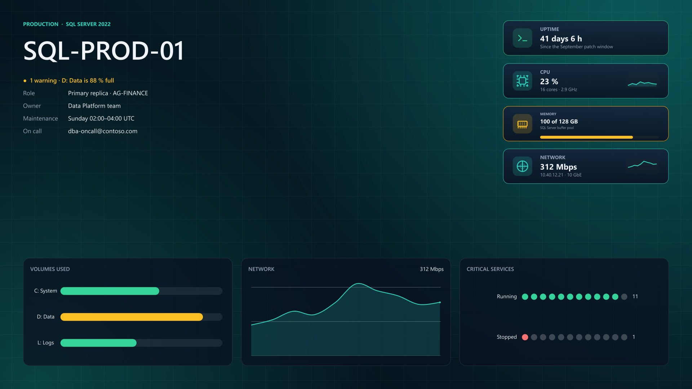

- **Your data, time-boxed.** Built-in system facts, plus any value from
  CIM, the registry, Active Directory, a REST API or a monitoring export.
  A slow or broken source falls back to a default instead of blocking
  sign-in.
- **One look, any screen.** Six themes in light and dark, layout regions
  that keep the taskbar and desktop icons clear, and one image per monitor
  at its own size and scale.
- **More than text.** Metric cards, tables, lists, calendar heatmaps,
  timelines, treemaps, Mermaid diagrams, QR codes, ChartForgeX charts and
  topology maps, coloured by warning and critical thresholds.
- **Built for fleets.** Render to a file, the current user, every profile
  or the lock screen, and run it from Task Scheduler, Group Policy, Intune,
  Configuration Manager or Remote Desktop session hosts.

You can read about the project's backstory in this
[blog post](https://evotec.xyz/powerbginfo-powershell-alternative-to-sysinternals-bginfo/).

## Installation

Install from the [PowerShell Gallery](https://www.powershellgallery.com/packages/PowerBGInfo):

```powershell
Install-Module -Name PowerBGInfo -Scope CurrentUser
```

PowerBGInfo runs in Windows PowerShell 5.1 and PowerShell 7 on Windows.
The rendering and desktop libraries ship inside the module, so nothing
else needs installing. Releases are Authenticode-signed by Evotec. Run the
same command again to update.

## Quick start

Collect the data first, then draw it. This renders a file and leaves the
desktop alone:

```powershell
$facts = Get-BGInfoSystemInfo

$render = @{
    Theme                  = 'Graphite'
    Target                 = 'File'
    ConfigurationDirectory = "$env:TEMP\PowerBGInfo"
    OutputFileName         = 'wallpaper.png'
}
New-BGInfo @render {
    New-BGInfoBackground
    New-BGInfoLabel -Name $facts.ComputerName -FontSize 56
    New-BGInfoValue -Name 'User' -Value $facts.LoggedOnUser
    New-BGInfoValue -Name 'Windows' -Value $facts.OSName
    New-BGInfoValue -Name 'Uptime' -Value $facts.UptimeText
    New-BGInfoValue -Name 'IP address' -Value $facts.IPv4Address
    $facts.Disks | New-BGInfoTable -Region Right -Title 'Disks' `
        -Property Drive, FreeGB, UsedPercent
}
```

`New-BGInfo` returns the path of the image. Open it, adjust the layout,
and when it looks right drop `Target = 'File'`: the default target,
`Wallpaper`, applies it to the signed-in user's desktop.
`Examples/Run.BGInfo.Template.ps1` is a copy-and-fill starting point with
your own data function.

## Run it in production

PowerBGInfo renders and applies once per run; schedule it to keep the
values current. The deployment guides cover the whole route, with a
tested reference script:

| Guide | Covers |
| --- | --- |
| [Run in production](https://evotec.xyz/projects/powerbginfo/docs/deployment/) | What one run does, choosing a route, installing the module for all users, the reference script |
| [Task Scheduler](https://evotec.xyz/projects/powerbginfo/docs/task-scheduler/) | Logon, unlock and timed refresh for every user; machine images as SYSTEM |
| [Group Policy](https://evotec.xyz/projects/powerbginfo/docs/group-policy/) | Startup install, Preferences scheduled task, logon scripts, wallpaper and lock screen policies |
| [Microsoft Intune](https://evotec.xyz/projects/powerbginfo/docs/intune/) | Win32 app, platform scripts, Remediations, Personalization CSP |
| [Configuration Manager](https://evotec.xyz/projects/powerbginfo/docs/configuration-manager/) | Applications, packages and Run Scripts |
| [Remote Desktop and Azure Virtual Desktop](https://evotec.xyz/projects/powerbginfo/docs/remote-desktop/) | Session hosts, AVD multi-session and personal, Windows 365 |
| [Security and operations](https://evotec.xyz/projects/powerbginfo/docs/security/) | Rights, signing and `AllSigned`, App Control, logging |
| [Troubleshooting](https://evotec.xyz/projects/powerbginfo/docs/troubleshooting/) | Reverting, black, stretched or blurry wallpapers, BGInfo migration, the lock screen |

The guides' source is in
[`Website/content/project-docs/docs`](Website/content/project-docs/docs).

## Themes

`-Theme` gives text, panels, charts, diagrams, tiles, widgets and the
backdrop one look. Every PowerBGInfo cmdlet inside the script block uses
the theme for the parameters you leave out; parameters you set win.

```powershell
New-BGInfo -Theme Aurora -ThemeMode Light -Target File `
    -ConfigurationDirectory "$env:TEMP\PowerBGInfo" `
    -OutputFileName 'themed.png' {
    New-BGInfoBackground -Width 1920 -Height 1080
    New-BGInfoLabel -Name 'SQL-PROD-01' -FontSize 64
    New-BGInfoLabel -Name 'PRODUCTION' -Accent
    New-BGInfoValue -Name 'Owner' -Value 'Data Platform'
    New-BGInfoChart -Region Right -Title 'CPU' -Kind Area `
        -Values 12, 30, 22 -NoHistory
}
```

Presets: `Graphite`, `Midnight`, `Aurora`, `Ember`, `Orchid` and
`Corporate`, each light and dark. `New-BGInfoTheme` customizes one with
`-Accent`, `-SecondaryAccent`, `-Surface`, `-CornerRadius`,
`-FontFamilyName` and `-Scale` for high-DPI screens.

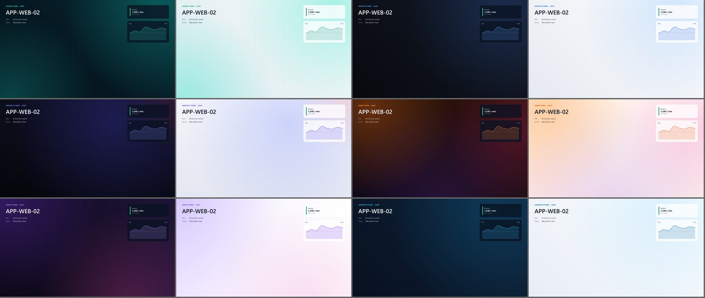

`New-BGInfoBackground` paints the backdrop: a base colour, an optional
image (`-ImagePath`), a gradient, glows and a dot or grid pattern. Without
`-Width` and `-Height` it renders at the size of the target monitor.

## Layout regions

Panels flow into named regions instead of hand-placed coordinates, so one
script fits 1920x1080, 2560x1440, ultrawide and portrait screens.

| Region | Behaviour |
| --- | --- |
| `Top`, `Bottom` | Full-width bands. Panels flow left to right. |
| `Left`, `Right` | Columns between the bands. Panels stack top to bottom. |
| `Center` | The space between the columns, stacked and centred. |

```powershell
New-BGInfo -Theme Graphite -Target File `
    -ConfigurationDirectory "$env:TEMP\PowerBGInfo" `
    -OutputFileName 'regions.png' {
    New-BGInfoLayout -IconAreaWidth 96 -ColumnWidth 480
    New-BGInfoValue -Name 'Host' -Value $env:COMPUTERNAME
    New-BGInfoChart -Region Right -Title 'CPU' -Kind Area `
        -Values 12, 30, 22 -NoHistory
    New-BGInfoMetric -Region Right -Label 'Memory' -Value 71 -Unit '%'
    New-BGInfoChart -Region Bottom -Title 'Network' -Kind Line `
        -Values 120, 180, 160 -NoHistory
}
```

The safe area keeps the taskbar free and, with `-IconAreaWidth`, the
desktop icons. Items without `-Region` keep `-Anchor`, `-OffsetX`,
`-OffsetY`, `-PositionX` and `-PositionY`.

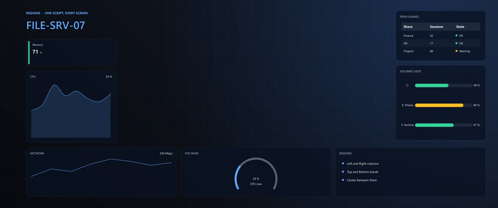

## Widgets

Each widget is a small cmdlet with the panel, header (`-Title`, `-Note`),
placement (`-Region` or `-Anchor`) and theme of the other panels.

| Cmdlet | Shows |
| --- | --- |
| `New-BGInfoMetric` | One KPI with trend, caption, history and status |
| `New-BGInfoTable` | Rows and columns from piped objects, with status dots |
| `New-BGInfoList` | Bullets, numbers, a checklist or status rows |
| `New-BGInfoCalendarHeatmap` | One cell per day |
| `New-BGInfoTimeline` | Ranges on lanes with a Now marker |
| `New-BGInfoTreemap` | Sizes as nested rectangles |
| `New-BGInfoMermaid` | A diagram from Mermaid text, rendered without a browser |
| `New-BGInfoQRCode` | A scannable link, for example to open a ticket |

```powershell
$flow = @'
flowchart LR
  A[Service desk] --> B[On call] --> C[Major incident]
'@
$help = 'https://help.contoso.com/new?asset=CT-04217'

New-BGInfo -Theme Midnight -Target File `
    -ConfigurationDirectory "$env:TEMP\PowerBGInfo" `
    -OutputFileName 'widgets.png' {
    New-BGInfoBackground
    New-BGInfoLabel -Name $env:COMPUTERNAME -FontSize 56
    Get-Process | Sort-Object -Property CPU -Descending |
        Select-Object -First 5 |
        New-BGInfoTable -Region Right -Title 'Top processes' `
            -Property Name, Id
    New-BGInfoQRCode -Region Right -Url $help -Title 'Scan for help' `
        -Caption 'help.contoso.com'
    New-BGInfoMermaid -Region Bottom -Title 'Escalation' -Definition $flow
}
```

QR codes are encoded by [CodeGlyphX](https://github.com/EvotecIT/CodeGlyphX);
Mermaid diagrams are parsed and drawn by ChartForgeX.Mermaid. Gauges and
radials stay `New-BGInfoChart -Kind Gauge`, `Circle` or `RadialBar`.

| | |
| --- | --- |
| 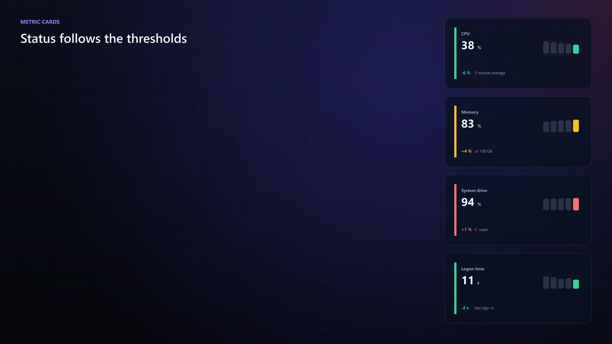 | 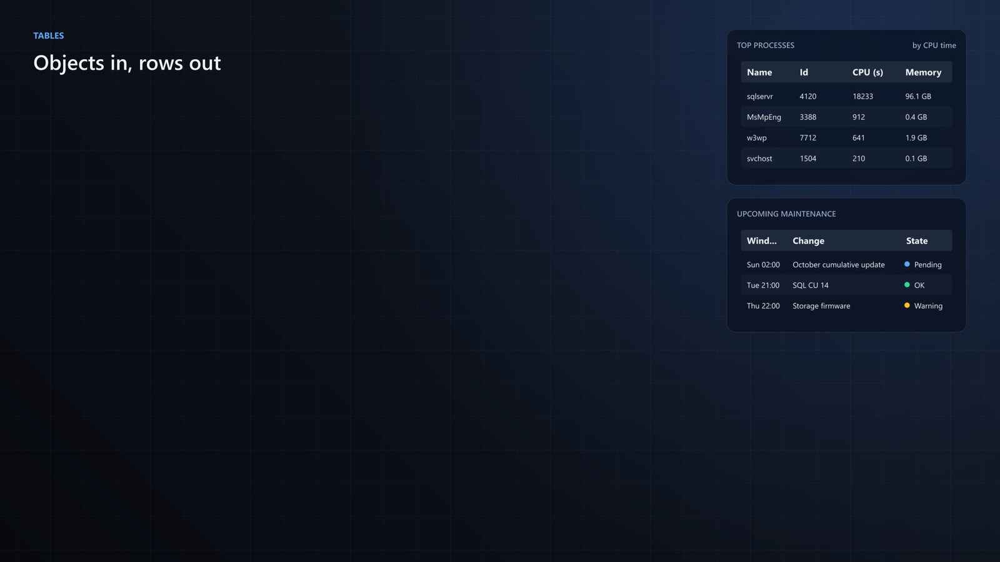 |
| 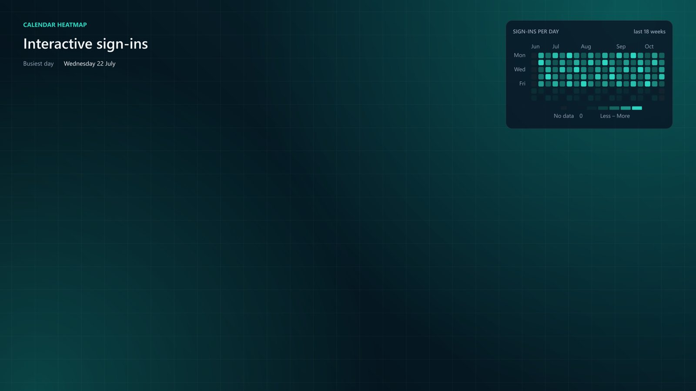 | 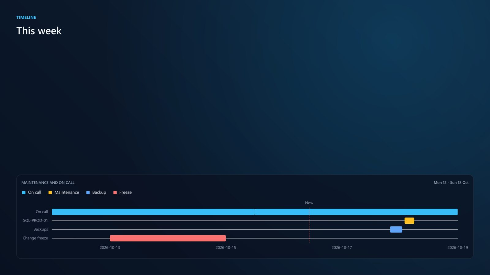 |
| 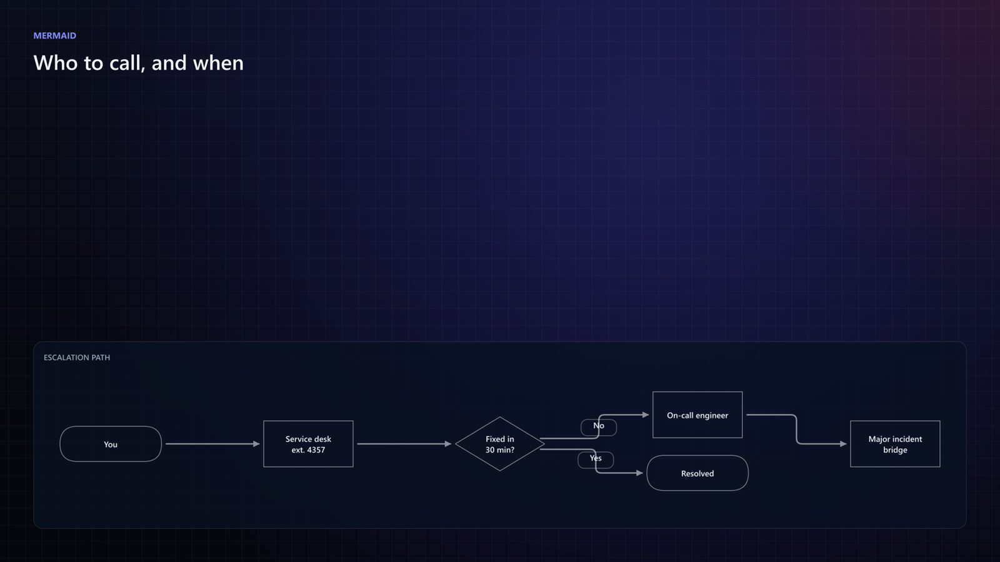 |  |

## Status thresholds

`-WarningThreshold`, `-CriticalThreshold` and
`-ThresholdDirection Above|Below` choose ok, warning or critical colours
from the value, so scripts no longer pick colours by hand. Bar, progress,
bullet and pictorial charts colour each row; gauges, circles and lines take
the colour of the latest value; `New-BGInfoMetric` and
`New-BGInfoVisualCanvasTile -StatusValue` set their status.

```powershell
$volumes = @{
    Title             = 'Volumes used'
    Kind              = 'ProgressBar'
    Values            = 61, 88, 96
    Labels            = 'C:', 'D:', 'L:'
    Maximum           = 100
    ValueSuffix       = ' %'
    WarningThreshold  = 80
    CriticalThreshold = 90
}
$memory = @{
    Label              = 'Free memory'
    Value              = 9
    Unit               = '%'
    WarningThreshold   = 15
    CriticalThreshold  = 5
    ThresholdDirection = 'Below'
}
New-BGInfo -Theme Graphite -Target File `
    -ConfigurationDirectory "$env:TEMP\PowerBGInfo" `
    -OutputFileName 'thresholds.png' {
    New-BGInfoBackground
    New-BGInfoChart -Region Bottom @volumes -NoHistory
    New-BGInfoMetric -Region Right @memory
}
```

## Your data, then the wallpaper

Collecting the data is usually the hard part, so keep it apart from the
layout. Every example starts with a data function that returns plain
values, and the `New-BGInfo` block only reads them.

```powershell
function Get-MyWallpaperData {
    # your logic: CIM, registry, Active Directory, a REST API...
    @{ Owner = 'Finance IT'; DiskUsed = 63; Cpu = 12, 18, 25 }
}

$source = @{
    Name           = 'Wallpaper data'
    TimeoutSeconds = 15
    ScriptBlock    = ${function:Get-MyWallpaperData}
    Default        = @{ Owner = 'unknown'; DiskUsed = 0; Cpu = @(0) }
}
$data = Invoke-BGInfoDataSource @source

New-BGInfo -Theme Graphite -Target File `
    -ConfigurationDirectory "$env:TEMP\PowerBGInfo" `
    -OutputFileName 'data.png' {
    New-BGInfoBackground
    New-BGInfoLabel -Name $data.Owner -FontSize 56
    New-BGInfoMetric -Region Right -Label 'System drive' `
        -Value $data.DiskUsed -Unit '%' -WarningThreshold 80
    New-BGInfoChart -Region Right -Title 'CPU' -Kind Area `
        -Values $data.Cpu -NoHistory
}
```

- `Invoke-BGInfoDataSource` runs the script block in its own runspace.
  When it throws, returns nothing or exceeds `-TimeoutSeconds`, it writes a
  warning and returns `-Default`, so the wallpaper still renders. Pass the
  caller's variables with `-ArgumentList`.
- `Get-BGInfoSystemInfo` returns the facts support asks for first as one
  plain object: computer, user and signed-in session user, domain, OS name,
  version and build, last boot and uptime, IPv4, fixed disks, last
  installed update, Defender state and signature age, and BitLocker state.
  Every probe is read-only and has a time limit; what cannot be read is
  `Unknown`. Replace it with your own function that returns the same
  property names and the layout keeps working.
- `Get-BGInfoMonitor` lists the monitors with the `Index` that
  `-MonitorIndex` takes, their bounds, the primary flag and the display
  scale. Loop over it to render one image per monitor;
  `Examples/Run.BGInfo.PerMonitor.ps1` shows how.

Built-in value tokens such as `HostName`, `LoggedOnUser`, `OSName`,
`Uptime`, `LastPatch`, `DefenderStatus`, `BitLockerStatus` and
`DiskSummary` also work directly in `New-BGInfoValue -BuiltinValue`.

## Showcase

Four wallpapers, each built for one job, share one theme and start with a
data block. Every scenario renders in light and dark at any resolution and
writes a file without touching the desktop.

| Scenario | What it answers | Script |
| --- | --- | --- |
| Server status | Is this server healthy? Uptime, disks, services, network. | `Examples/Run.BGInfo.ServerStatus.ps1` |
| Help desk | How do I get help, and what do I tell them? | `Examples/Run.BGInfo.HelpDesk.ps1` |
| Lab or classroom | Which seat is this, and when does it reset? | `Examples/Run.BGInfo.Classroom.ps1` |
| Admin workstation | Is this privileged machine healthy, and where may it connect? | `Examples/Run.BGInfo.AdminWorkstation.ps1` |

| | |
| --- | --- |
| 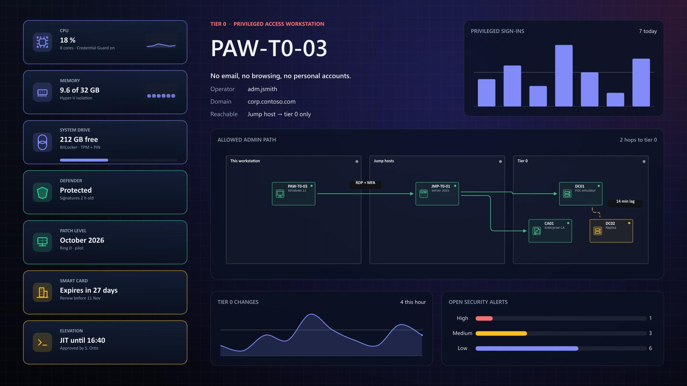 | 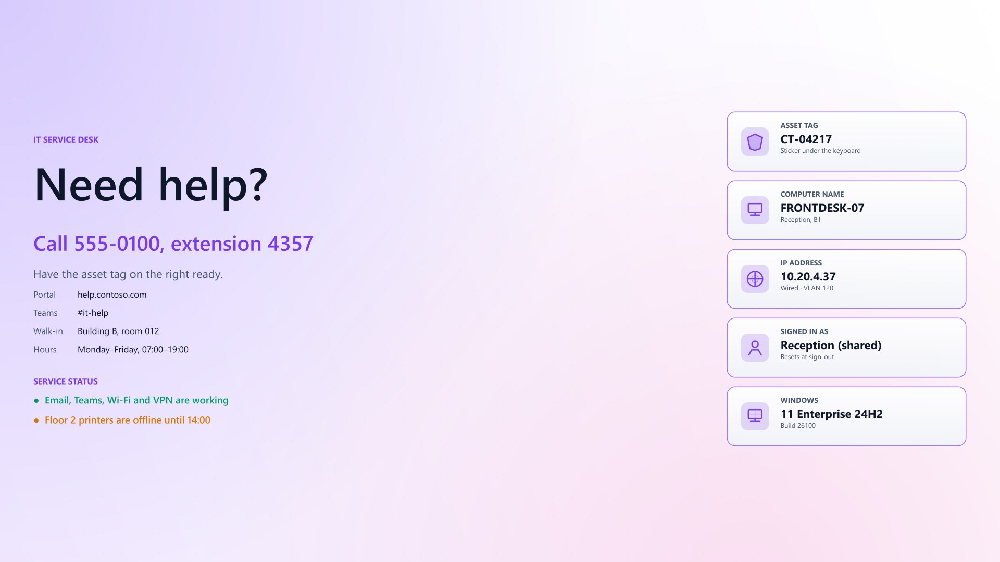 |

```powershell
.\Examples\Run.BGInfo.ServerStatus.ps1 -Theme Light -Width 2560 -Height 1440
.\Examples\Run.BGInfo.Showcase.ps1 -OutputDirectory "$env:TEMP\Showcase"
```

`Examples/Features` has one script per feature, and
`Examples/Run.BGInfo.Features.ps1` renders them all.

## Charts, topology and visual canvases

`New-BGInfoChart` draws ChartForgeX charts as transparent overlays:
`Sparkline`, `Line`, `Area`, `Bar`, `HorizontalBar`, `Gauge`, `Circle`,
`RadialBar`, `Bullet`, `Pie`, `Donut`, `ProgressBar` and `Pictorial`.
Charts keep their history between runs in
`<ConfigurationDirectory>\Charts`, keyed by `-Id`, so a scheduled task
builds a rolling trend; `-Metric CpuPercent`, `MemoryPercent` and
`DiskFreePercent` sample the machine for you.

```powershell
New-BGInfo -Target File -ConfigurationDirectory "$env:TEMP\PowerBGInfo" `
    -OutputFileName 'charts.png' -BackgroundColor Black {
    New-BGInfoValue -BuiltinValue HostName -Color White
    New-BGInfoChart -Id 'cpu' -Title 'CPU' -Metric CpuPercent `
        -ValueSuffix '%' -Kind Sparkline -MaxPoints 60 -Anchor BottomLeft
}
```

`New-BGInfoTopology` places a compact service or network map, and
`New-BGInfoVisualCanvas` with `New-BGInfoVisualCanvasTile` builds hero
overlays with icon tiles, progress rails and mini charts. The scripts in
`Examples/Scripts` show complete layouts:

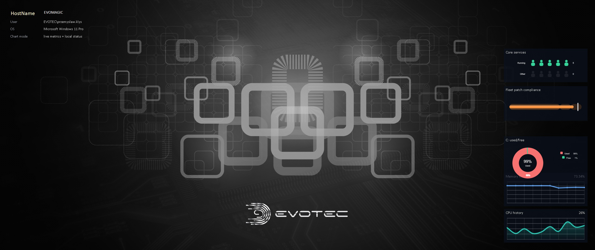

Colour parameters accept ChartForgeX colour names, design tokens such as
`Emerald400`, and hex strings (`#RGB`, `#RGBA`, `#RRGGBB`, `#RRGGBBAA`).
Labels, values and chart headers support font family, size, weight,
italic, underline, strikethrough, baseline and casing.

## JSON configurations

A layout can be exported to JSON, reviewed and versioned on its own, and
rendered again later:

```powershell
$json = "$env:TEMP\PowerBGInfo\layout.json"
New-BGInfo -Target File -ConfigurationDirectory "$env:TEMP\PowerBGInfo" `
    -JsonPath $json -ExportOnly {
    New-BGInfoValue -BuiltinValue HostName -Name 'Machine'
    New-BGInfoValue -BuiltinValue LoggedOnUser -Name 'User'
}
Invoke-BGInfo -Path $json -NoApply
```

The JSON keeps built-in value tokens, chart metrics, themes, regions,
widgets, layout and target settings. It does not keep PowerShell code: a
`foreach` or a data function runs once at export and its results are
stored as fixed values. Sample files are in `Examples/Configuration`.

## Known issues

The VS Code PowerShell extension has a known problem with the module in
Windows PowerShell 5.1. The regular Windows PowerShell 5.1 console,
Windows PowerShell ISE and PowerShell 7 work.

## Development and validation

Build and test the current checkout:

```powershell
dotnet test .\Sources\PowerBGInfo.sln
.\PowerBGInfo.Tests.ps1
```

For a fuller pass, the validation script builds the solution and runs the
.NET and Pester tests and the JSON rendering checks; add `-KeepArtifacts`
to keep the rendered files:

```powershell
.\Build\Validate-PowerBGInfo.ps1 -Configuration Release
```
