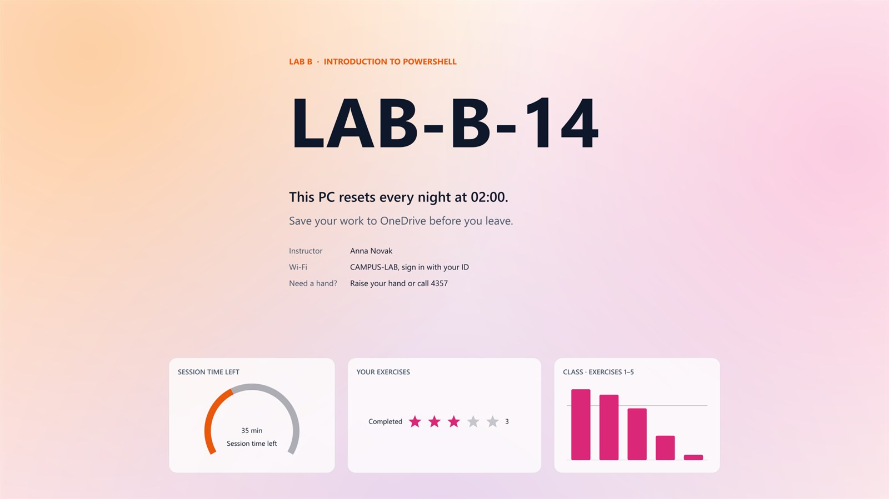
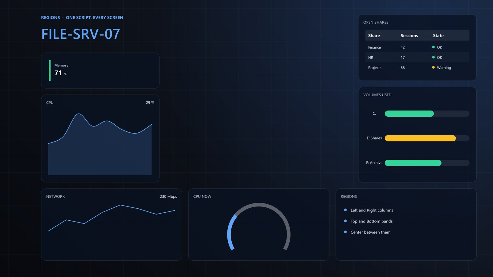
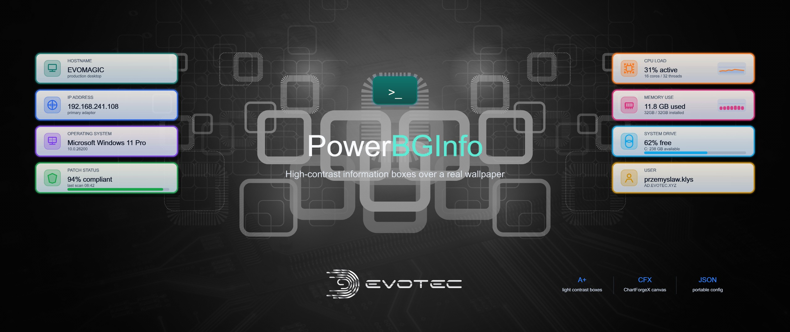
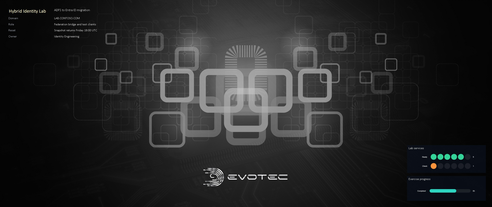
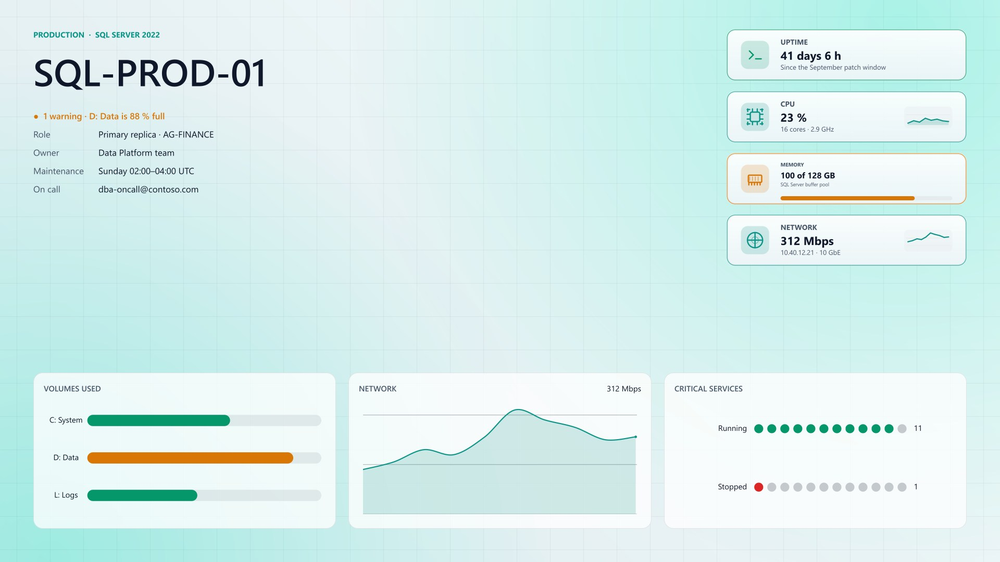
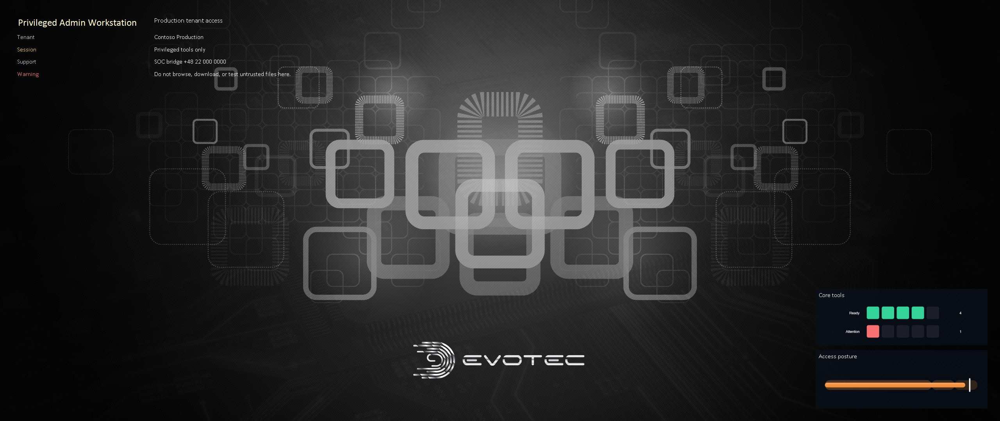
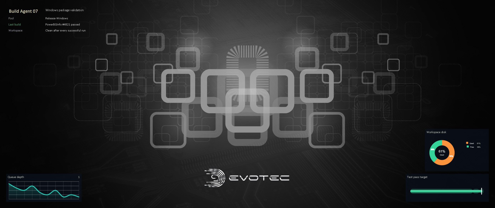
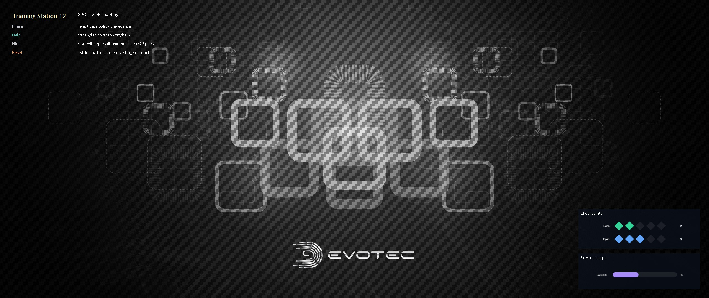

<p align="center">
  <a href="https://github.com/EvotecIT/PowerBGInfo/actions/workflows/test-dotnet.yml"></a>
  <a href="https://github.com/EvotecIT/PowerBGInfo/actions/workflows/test-powershell.yml"></a>
  <a href="https://codecov.io/gh/EvotecIT/PowerBGInfo"></a>
  <a href="https://www.powershellgallery.com/packages/PowerBGInfo"></a>
  <a href="https://www.powershellgallery.com/packages/PowerBGInfo"></a>
  <a href="https://github.com/EvotecIT/PowerBGInfo"></a>
</p>

<p align="center">
  <a href="https://www.powershellgallery.com/packages/PowerBGInfo"></a>
  <a href="https://github.com/EvotecIT/PowerBGInfo"></a>
  <a href="https://github.com/EvotecIT/PowerBGInfo"></a>
  <a href="https://www.powershellgallery.com/packages/PowerBGInfo"></a>
</p>

<p align="center">
  <a href="https://twitter.com/PrzemyslawKlys"></a>
  <a href="https://evotec.xyz/hub"></a>
  <a href="https://www.linkedin.com/in/pklys"></a>
  <a href="https://evo.yt/discord"></a>
</p>

**PowerBGInfo** creates Windows desktop and logon-screen backgrounds from PowerShell.
Use it to put machine identity, support details, user/session context, operational status, charts, and small topology diagrams directly on the wallpaper.

You can read about this project on this [blog post](https://evotec.xyz/powerbginfo-powershell-alternative-to-sysinternals-bginfo/) that tells a little backstory and shows few things.

## What it can do

- Generate a wallpaper from a normal PowerShell script.
- Use built-in values such as host name, user name, OS details, CPU, RAM, BIOS, and disk information.
- Add custom values from your own PowerShell, CIM/WMI, registry, AD, APIs, or RMM data.
- Style labels and values independently with bold text and underlines.
- Place information in corners, center positions, or explicit screen coordinates.
- Wrap long values such as AD computer descriptions with `-ValueWrapWidth`.
- Apply output to the current user, all users, the logon/lock screen, or just write a file.
- Preserve the current Windows wallpaper slideshow by rendering one BGInfo image per slideshow source.
- Handle solid-color desktops when Windows has no wallpaper file.
- Add transparent ChartForgeX charts and topology diagrams on top of real wallpapers.
- Pick a complete look with one parameter: `New-BGInfo -Theme Aurora` (six presets, light and dark).
- Flow panels into Left, Right, Top, Bottom and Center regions that keep the taskbar and desktop icons free, on any screen size.
- Add metric cards, tables, lists, calendar heatmaps, timelines, treemaps, Mermaid diagrams and QR codes as small cmdlets.
- Turn values amber or red automatically with warning and critical thresholds.
- Keep data collection apart from rendering: time-boxed data sources with fallbacks, and a read-only system snapshot.
- Render and compose wallpaper content without a production dependency on `System.Drawing`.
- Export JSON configurations when you need a portable deployment artifact.

## Installation

Install from [PowerShell Gallery](https://www.powershellgallery.com/packages/PowerBGInfo):

```powershell
Install-Module PowerBGInfo -Force -Verbose
```

PowerBGInfo no longer requires separate PowerShell module installs for helper modules such as `DesktopManager` or `ImagePlayground`.
When there's an update, use the same `Install-Module` command again.

## Quick start

Create a simple generated wallpaper:

```powershell
New-BGInfo -MonitorIndex 0 {
    New-BGInfoValue -BuiltinValue HostName -Color Red -FontSize 24 -Bold
    New-BGInfoValue -BuiltinValue FullUserName -Name 'User'
    New-BGInfoValue -BuiltinValue OSName -Name 'OS'
    New-BGInfoValue -BuiltinValue CpuName -Name 'CPU'
    New-BGInfoValue -BuiltinValue RAMSize -Name 'Memory'
} -ConfigurationDirectory 'C:\ProgramData\PowerBGInfo' -WallpaperFit Fill
```

Generate an image file without changing the current wallpaper:

```powershell
New-BGInfo -MonitorIndex 0 -Target File {
    New-BGInfoValue -Name 'Machine' -Value $env:COMPUTERNAME
    New-BGInfoValue -Name 'Support' -Value 'helpdesk@contoso.com'
} -ConfigurationDirectory 'C:\Temp\PowerBGInfo' -OutputFileName 'Preview.png' -BackgroundColor Black
```

Wrap long values:

```powershell
$description = 'Long computer description from AD, inventory, RMM, CMDB, or any other source.'

New-BGInfo -MonitorIndex 0 -ValueWrapWidth 420 {
    New-BGInfoValue -Name 'Description' -Value $description -Color White -ValueColor LightGray
} -ConfigurationDirectory 'C:\ProgramData\PowerBGInfo'
```

Apply the same generated wallpaper for existing users and the default profile used by new users:

```powershell
New-BGInfo -MonitorIndex 0 -AllUsers {
    New-BGInfoValue -BuiltinValue HostName
    New-BGInfoValue -BuiltinValue OSName -Name 'OS'
} -ConfigurationDirectory 'C:\ProgramData\PowerBGInfo' -WallpaperFit Fill
```

Apply to both the desktop wallpaper and the Windows logon/lock screen:

```powershell
New-BGInfo -MonitorIndex 0 -Target Both {
    New-BGInfoValue -BuiltinValue HostName
    New-BGInfoValue -BuiltinValue OSName -Name 'OS'
} -ConfigurationDirectory 'C:\ProgramData\PowerBGInfo' -WallpaperFit Fill
```

`-AllUsers`, `-Target LogonScreen`, and `-Target Both` need elevation because they write system-level wallpaper settings.

## Showcase

Four wallpapers, each built for one job. They share one HUD through `New-BGInfo -Theme`: the same margins, glass panels, type scale and status colours. Every scenario starts with a data block, renders in light and dark at any resolution, uses a generated background, and writes a file without touching the desktop. `Examples/Showcase/HudTheme.ps1` still returns the splat tables for older scripts.

| Scenario | What it answers | Script |
| --- | --- | --- |
| Server status | Is this server healthy? Uptime, disks, services, network. | `Examples/Run.BGInfo.ServerStatus.ps1` |
| Help desk | How do I get help, and what do I tell them? | `Examples/Run.BGInfo.HelpDesk.ps1` |
| Lab or classroom | Which seat is this, and when does it reset? | `Examples/Run.BGInfo.Classroom.ps1` |
| Admin workstation | Is this privileged machine healthy, and where may it connect? | `Examples/Run.BGInfo.AdminWorkstation.ps1` |




Render one scenario, or all of them with a `manifest.json` that describes each image:

```powershell
.\Examples\Run.BGInfo.ServerStatus.ps1 -Theme Light -Width 2560 -Height 1440
.\Examples\Run.BGInfo.Showcase.ps1 -OutputDirectory C:\Temp\Showcase
```

Light and dark renders of every scenario are in `Examples/Showcase/Images`. The runner writes PNG files and `manifest.json` to `Examples/Output/Showcase` unless you pass `-OutputDirectory`.

## Generated backgrounds

`New-BGInfoBackground` replaces the wallpaper image with a generated backdrop, so the wallpaper looks the same on every machine and resolution. Layers paint in order: base color, optional image, linear gradient, glows, then a dot or grid pattern. A translucent gradient over `-ImagePath` acts as a scrim that keeps text readable on a photo.

```powershell
New-BGInfo -Target File {
    New-BGInfoBackground -Width 1920 -Height 1080 `
        -Gradient '#062A33', '#050A14' -Pattern Grid -Glow @(
            New-BGInfoBackgroundGlow -X 0.9 -Y 0.05 -Radius 0.55 -Color '#14B8A655'
        )
    New-BGInfoLabel -Name 'SQL-PROD-01' -Color White -FontSize 72
} -ConfigurationDirectory C:\Temp -OutputFileName 'server.png'
```

Glow positions are fractions of the backdrop, so the same definition works at 1920x1080 and 2560x1440. With no `-Width` or `-Height`, the backdrop uses the target monitor size. A background also replaces wallpaper slideshow sources, and it round-trips through JSON export.

Charts and topology diagrams share one panel style. Give them `-BackgroundColor`, `-BorderColor` and `-CornerRadius` so charts, topology and visual canvas tiles look like parts of the same HUD. Topology panels also take `-Padding` and header settings (`-TitleColor`, `-TitleFontSize`, `-TitleFontWeight`, `-TitleTextCase`). `New-BGInfoTopology -Scale 2` renders nodes and labels twice as large for high-resolution screens. Labels created with `New-BGInfoLabel` span both text columns, so a large heading such as a host name no longer pushes the value column to the right.

## Themes

`-Theme` gives text, panels, charts, diagrams, tiles, widgets and the backdrop one look. Every PowerBGInfo cmdlet inside the script block uses the theme for the parameters you leave out; parameters you set always win, and nothing is themed without `-Theme`.

```powershell
New-BGInfo -Theme Aurora -ThemeMode Light -Target File {
    New-BGInfoBackground -Width 1920 -Height 1080          # paints the theme backdrop
    New-BGInfoLabel -Name 'SQL-PROD-01' -FontSize 64        # headings use the theme ink
    New-BGInfoLabel -Name 'PRODUCTION' -Accent              # -Accent, -Muted or -Status Warning
    New-BGInfoValue -Name 'Owner' -Value 'Data Platform'
    New-BGInfoChart -Region Right -Title 'CPU' -Kind Area -Values 12, 30, 22 -NoHistory
} -ConfigurationDirectory C:\Temp -OutputFileName 'themed.png'
```

Presets: `Graphite`, `Midnight`, `Aurora`, `Ember`, `Orchid` and `Corporate`, each light and dark. `New-BGInfoTheme` customizes one: `-Accent`, `-SecondaryAccent`, `-Surface`, `-CornerRadius`, `-FontFamilyName`, and `-Scale` for high-DPI screens (about 1.33 at 2560x1440, 2 at 3840x2160).


## Layout regions

Panels flow into named regions instead of hand-placed coordinates, so one script lays out correctly at 1920x1080, 2560x1440, ultrawide and portrait. PowerBGInfo renders one image per `-MonitorIndex`, and regions resolve against that image, so a script run per monitor fits each one.

| Region | Behaviour |
| --- | --- |
| `Top`, `Bottom` | Full-width bands. Panels flow left to right; unsized panels share the width, and a row of fixed widths is centered. If fixed panels and their gaps do not fit, their widths shrink proportionally to stay inside the band. |
| `Left`, `Right` | Columns between the bands. Panels stack top to bottom; unsized panels share the height, up to 36 % of the screen each. |
| `Center` | The space between the columns, stacked and centered. |

```powershell
New-BGInfo -Theme Graphite -Target File {
    New-BGInfoLayout -IconAreaWidth 96 -ColumnWidth 480     # optional: margins, gap, taskbar, icon area
    New-BGInfoValue -Name 'Host' -Value $env:COMPUTERNAME
    New-BGInfoChart -Region Right -Title 'CPU' -Kind Area -Values 12, 30, 22 -NoHistory
    New-BGInfoMetric -Region Right -Label 'Memory' -Value 71 -Unit '%'
    New-BGInfoChart -Region Bottom -Title 'Network' -Kind Line -Values 120, 180, 160 -NoHistory
} -ConfigurationDirectory C:\Temp -OutputFileName 'regions.png'
```

The safe area keeps the taskbar free (estimated from the height, 48 px at 1080 and 64 px at 1440; `-TaskbarReserve` overrides it) and, with `-IconAreaWidth`, the desktop icons and the text block. The text block reserves its rectangle, so a column next to it starts below it. Items without `-Region` keep `-Anchor`, `-OffsetX`, `-OffsetY` and `-PositionX`/`-PositionY`. `New-BGInfoVisualCanvas -Region Right` stacks its tiles in the region.




## Widgets

Each widget is a small cmdlet over a ChartForgeX producer and shares the panel, header (`-Title`, `-Note`), placement (`-Region` or `-Anchor`) and theme of the other panels. `-Scale` enlarges the content inside the same panel.

| Cmdlet | Shows | Input |
| --- | --- | --- |
| `New-BGInfoMetric` | One KPI with trend, caption, history and status | `-Label -Value -Unit -Trend -Caption -History` |
| `New-BGInfoTable` | Rows and columns, status dots | Piped objects with `-Property` (calculated columns too), or `-Column` and `-Row` |
| `New-BGInfoList` | Bullets, numbers, checklist, status rows | Strings, or hashtables/objects with Text, Value, Status, Checked |
| `New-BGInfoCalendarHeatmap` | One cell per day | Objects with Date and Value, plain dates, or `-Data @{ date = value }` |
| `New-BGInfoTimeline` | Ranges on lanes with a Now marker | `New-BGInfoTimelineItem`, or hashtables with Lane, Label, Start, End, Category |
| `New-BGInfoTreemap` | Sizes as nested rectangles | Objects with Name, Value, Group, or `-Data @{ name = size }` |
| `New-BGInfoMermaid` | A diagram from Mermaid text | `-Definition` |
| `New-BGInfoQRCode` | A scannable link | `-Url`, `-Caption` |

```powershell
Get-Process | Sort-Object CPU -Descending | Select-Object -First 5 |
    New-BGInfoTable -Region Right -Title 'Top processes' -Property Name, Id, @{ Name = 'CPU s'; Expression = { [Math]::Round($_.CPU) } }
New-BGInfoQRCode -Region Right -Url 'https://help.contoso.com/new?asset=CT-04217' -Title 'Scan for help' -Caption 'help.contoso.com'
New-BGInfoMermaid -Region Bottom -Title 'Escalation' -Definition "flowchart LR`n  A[Service desk] --> B[On call] --> C[Major incident]"
```

Gauges and radials stay `New-BGInfoChart -Kind Gauge`, `Circle` or `RadialBar`. QR codes are encoded by [CodeGlyphX](https://github.com/EvotecIT/CodeGlyphX) and drawn with whole-pixel modules on a light field; Mermaid diagrams are parsed and rendered by ChartForgeX.Mermaid without a browser.

| | |
| --- | --- |
|  |  |
|  |  |
|  |  |

## Status thresholds

`-WarningThreshold`, `-CriticalThreshold` and `-ThresholdDirection Above|Below` pick ok, warning or critical colors from the value, so scripts no longer hand-pick colors. Bar, progress, bullet and pictorial charts color each row; gauges, circles and lines take the color of the latest value; `New-BGInfoMetric` and `New-BGInfoVisualCanvasTile -StatusValue` set their status. Colors come from the theme, or from light and dark defaults without one. An explicit `-LineColor`, `-Palette` or `-Accent` still wins.

```powershell
New-BGInfoChart -Region Bottom -Title 'Volumes used' -Kind ProgressBar -Values 61, 88, 96 -Labels 'C:', 'D:', 'L:' `
    -Maximum 100 -ValueSuffix ' %' -WarningThreshold 80 -CriticalThreshold 90 -NoHistory
New-BGInfoMetric -Label 'Free memory' -Value 9 -Unit '%' -WarningThreshold 15 -CriticalThreshold 5 -ThresholdDirection Below
```

## Your data, then the wallpaper

Collecting the data is usually the hard part, so keep it apart from the layout. Every example starts with a data function that returns plain values, and the `New-BGInfo` block only reads them. `Examples/Run.BGInfo.Template.ps1` is a copy-and-fill starting point.

```powershell
function Get-MyWallpaperData {
    # your logic: CIM, registry, Active Directory, a REST API or a monitoring export
    [pscustomobject] @{ Heading = $env:COMPUTERNAME; DiskUsed = 63; Cpu = 12, 18, 25 }
}

# A wallpaper must never fail or block logon because one source is slow or down.
$data = Invoke-BGInfoDataSource -Name 'Wallpaper data' -TimeoutSeconds 15 -ScriptBlock ${function:Get-MyWallpaperData} `
    -Default ([pscustomobject] @{ Heading = $env:COMPUTERNAME; DiskUsed = 0; Cpu = @(0) })

New-BGInfo -Theme Graphite -Target File {
    New-BGInfoBackground
    New-BGInfoLabel -Name $data.Heading -FontSize 56
    New-BGInfoMetric -Region Right -Label 'System drive' -Value $data.DiskUsed -Unit '%' -WarningThreshold 80
    New-BGInfoChart -Region Right -Title 'CPU' -Kind Area -Values $data.Cpu -NoHistory
} -ConfigurationDirectory C:\ProgramData\PowerBGInfo -OutputFileName 'wallpaper.png'
```

`Invoke-BGInfoDataSource` runs the script block in its own runspace. When it throws, returns nothing or exceeds `-TimeoutSeconds`, it writes a warning and returns `-Default`. Variables of the calling script are not visible inside it; pass them with `-ArgumentList`.

`Get-BGInfoSystemInfo` returns the facts support asks for first as one plain object: computer, user and console user, domain, OS name, version and build, last boot and uptime, IPv4, fixed disks (size, free, used %), last installed update, Defender state and signature age, and BitLocker state of the system drive. Every probe is read-only; the update, Defender, BitLocker, disk and console-user queries have a five-second WMI time limit, and a missing class, a timeout or a lack of elevation (BitLocker usually needs it) leaves that field `Unknown`. Wrap the call in `Invoke-BGInfoDataSource` for a hard limit on the whole snapshot. Replace it with your own function that returns the same property names and the presentation code keeps working.

## Running on a schedule

PowerBGInfo renders, and with a wallpaper or logon target applies, once per run. It does not install a scheduled task or keep running; schedule the script with Task Scheduler, Intune or your RMM tool.

- Wallpaper targets change the desktop of the account that runs the command, so run per-user wallpapers in the user's session, for example a logon task or a task that runs only when the user is logged on. Run it again to refresh the values.
- `-AllUsers`, `-Target LogonScreen` and `-Target Both` write system-level settings and need elevation.
- When a script runs as SYSTEM, built-in values such as `UserName` describe SYSTEM; `LoggedOnUser` (and `Get-BGInfoSystemInfo`) read the user at the console.
- Charts keep their history between runs in `<ConfigurationDirectory>\Charts`, keyed by `-Id`, so repeated runs build rolling trends (`-MaxPoints`, `-NoHistory`, `-ReplaceHistory`).
- `PowerBGInfo.Cli.exe --config <file.json>` renders a saved JSON configuration without PowerShell, and `--script` runs a PowerShell script that returns a configuration.

## Example outputs






## Common scenarios

| Scenario | PowerBGInfo feature |
| --- | --- |
| Lab or demo VM identity | Built-in values, custom values, positioned text |
| Shared admin workstation | Support details, tenant/customer context, warning text |
| Build or test host | Charts for CPU, memory, disk, service status, and targets |
| Training room or kiosk | Exercise phase, machine number, URLs, reset hints |
| Terminal server / RDS | Per-session script runs for user-specific values |
| Fleet deployment | `-AllUsers`, JSON export, scheduled task/RMM execution |
| Logon screen branding | `-Target LogonScreen` or `-Target Both` |

## Operational notes

- Solid-color desktops: when no wallpaper file exists, PowerBGInfo renders a blank image using the desktop background color or `-BackgroundColor`.
- Wallpaper slideshows: when no explicit `-FilePath` is provided and Windows has a wallpaper slideshow configured, PowerBGInfo renders every slideshow source image into the configuration directory and restarts the slideshow with the generated images while preserving DesktopManager slideshow options and interval. Use `-DisableWallpaperSlideshow` when you want one static generated wallpaper instead.
- Refresh behavior: by default the wallpaper is refreshed to avoid Windows caching issues; use `-DisableWallpaperRefresh` only when you need the old behavior.
- All users: use `-AllUsers` elevated. Use `-ExcludeDefaultUserProfile` to skip the default profile.
- Logon screen: use `-Target LogonScreen` or `-Target Both` elevated.
- Terminal server / RDS: run PowerBGInfo in each user session when you need per-user values such as `FullUserName`.
- File output: use `-Target File` and `-OutputFileName` when you want a preview or an image for another deployment system.

## Known issues

PowerBGInfo works in Windows PowerShell 5.1 and PowerShell 7+.
There is a known problem when running the module in the VS Code PowerShell extension on Windows PowerShell 5.1. The same module works in the regular Windows PowerShell 5.1 console, Windows PowerShell ISE, and PowerShell 7+.

## PowerShell inline usage

You can also render everything inline from PowerShell when you're exploring or authoring a layout:

```powershell
New-BGInfo -MonitorIndex 0 {
    # Add computer name from a built-in value.
    New-BGInfoValue -BuiltinValue HostName -Color Red -FontSize 20 -FontFamilyName 'Calibri'
    # Add current user from a built-in value.
    New-BGInfoValue -BuiltinValue FullUserName -Name "FullUserName" -Color White
    New-BGInfoValue -BuiltinValue CpuName
    New-BGInfoValue -BuiltinValue CpuLogicalCores
    New-BGInfoValue -BuiltinValue RAMSize
    New-BGInfoValue -BuiltinValue RAMSpeed

    # Add a section label without a value.
    New-BGInfoLabel -Name "Drives" -Color LemonChiffon -FontSize 16 -FontFamilyName 'Calibri'

    # Add drive details from regular PowerShell data.
    foreach ($Disk in (Get-Disk)) {
        $Volumes = $Disk | Get-Partition | Get-Volume
        foreach ($V in $Volumes) {
            New-BGInfoValue -Name "Drive $($V.DriveLetter)" -Value $V.SizeRemaining
        }
    }
} -FilePath $PSScriptRoot\Samples\PrzemyslawKlysAndKulkozaurr.jpg -ConfigurationDirectory $PSScriptRoot\Output -PositionX 100 -PositionY 100 -WallpaperFit Center
```

You can export the same inline authoring flow to JSON by adding `-JsonPath` and, when you only want the config file, `-ExportOnly`.
Example output:


## More layout and output options

- `-TextPosition`, `-PositionX`, `-PositionY`, `-SpaceX`, and `-SpaceY` control where the text block is placed.
- Labels, values, chart titles, and chart values support independent font family, size, color, numeric weight (`100` through `900`), italic, underline, strikethrough, baseline, and casing controls.
- Underline and strikethrough patterns are `None`, `Single`, `Double`, `Dotted`, `Dashed`, and `Wavy`. Baselines are `Normal`, `Subscript`, and `Superscript`. Casing transforms are `None`, `Uppercase`, `Lowercase`, `TitleCase`, `SentenceCase`, and `ToggleCase`.
- `-Bold` and `-Underline` remain convenient compatibility switches. The more specific `-FontWeight` and `-UnderlineStyle` parameters win when both forms are supplied. Value-specific parameters use the `Value` prefix, and chart title parameters use the `Title` prefix.
- `-UseScreenCoordinates` makes placement calculations match the monitor coordinate space.
- `-OutputFileName` controls the generated image name and path.
- `-Target File` writes PNG, GIF, JPEG, BMP, PPM, or TIFF according to `-OutputFileName`. Wallpaper and logon targets keep PNG, JPEG, or BMP and normalize other requested formats to PNG for Windows compatibility.
- `-DisableWallpaperSlideshow` forces static wallpaper output instead of preserving the active Windows slideshow.
- `-JsonPath` and `-ExportOnly` save reusable configuration without applying the wallpaper.
- `New-BGInfoChart`, `New-BGInfoTopology`, and `New-BGInfoVisualCanvas` add ChartForgeX-backed transparent overlays with optional chart history and reusable visual canvas boxes.

For example, this uses the complete style surface without changing the source strings:

```powershell
New-BGInfo -Target File -OutputFileName 'styled-wallpaper.tiff' {
    New-BGInfoLabel -Name 'SYSTEM DETAILS' `
        -FontFamilyName 'Segoe UI' -FontWeight 700 -Italic `
        -UnderlineStyle Double -TextCase TitleCase -Color Gold

    New-BGInfoValue -Name 'Computer' -BuiltinValue HostName `
        -FontWeight 600 -StrikethroughStyle Dotted `
        -ValueFontFamilyName 'Consolas' -ValueFontWeight 400 `
        -ValueUnderlineStyle Wavy -ValueBaseline Subscript `
        -ValueTextCase ToggleCase -ValueColor White
} -ConfigurationDirectory $PSScriptRoot\Output
```

PowerBGInfo produces final raster wallpaper images. Use ChartForgeX directly when the required output is native SVG or HTML; the same shared text-style engine is used by both projects.

## Deployment recipes

Custom text works on both sides of the layout, so you can compute the left column yourself instead of relying only on builtin labels:

```powershell
$bgHostname = $env:COMPUTERNAME
$bgUsername = if ($user = (Get-CimInstance Win32_ComputerSystem).UserName) {
    $user.Split('\')[-1]
} else {
    'Unknown'
}

New-BGInfo -MonitorIndex 0 -Target File {
    New-BGInfoValue -Name $bgHostname -Value $bgUsername -Color LemonChiffon -ValueColor White -FontSize 24 -FontFamilyName 'Calibri'
    New-BGInfoValue -Name 'Support' -Value 'helpdesk@contoso.com'
}
```

Apply the generated wallpaper for existing profiles and the default profile used by new users:

```powershell
New-BGInfo -MonitorIndex 0 -AllUsers {
    New-BGInfoValue -BuiltinValue HostName
    New-BGInfoValue -BuiltinValue OSName -Name 'OS'
} -ConfigurationDirectory 'C:\ProgramData\PowerBGInfo'
```

Skip the default profile if you only want current user profiles updated:

```powershell
New-BGInfo -MonitorIndex 0 -AllUsers -ExcludeDefaultUserProfile {
    New-BGInfoValue -BuiltinValue HostName
} -ConfigurationDirectory 'C:\ProgramData\PowerBGInfo'
```

Apply to the logon/lock screen, or to both the desktop wallpaper and logon screen in one run:

```powershell
New-BGInfo -MonitorIndex 0 -Target Both {
    New-BGInfoValue -BuiltinValue HostName
    New-BGInfoValue -BuiltinValue OSName -Name 'OS'
} -ConfigurationDirectory 'C:\ProgramData\PowerBGInfo'
```

For Remote Desktop Session Host / terminal server scenarios, run PowerBGInfo in each user session when you need per-user values such as `FullUserName`. `-AllUsers` is best for staging the same generated wallpaper to many profiles, not for rendering unique user data offline.

On Windows 11 24H2, keep the default wallpaper refresh behavior enabled unless you have a specific reason to disable it. PowerBGInfo writes a temporary refresh file first to avoid Windows reusing a cached wallpaper path after relogon.

## Charts

PowerBGInfo can place ChartForgeX charts directly on the generated wallpaper. The chart itself is rendered as a transparent overlay, then composited into the final image, so it works well on real wallpapers without a heavy dashboard frame.



The server status scenario above (`Examples/Run.BGInfo.ServerStatus.ps1`) combines:

- `ProgressBar` rows for volume capacity, coloured by status.
- An `Area` chart for a short network trend.
- `Pictorial` for running and stopped service counts.
- Visual canvas tiles with mini charts for uptime, CPU, memory and network.

All four panels splat the same `$hud.Panel` table, so they share fill, border, corner radius, padding and header style:

```powershell
$panel = @{
    BackgroundColor = '#0B1222C2'; BorderColor = '#FFFFFF1F'
    CornerRadius = 18; Padding = 20; TitleTextCase = 'Uppercase'
}
New-BGInfoChart @panel -Title 'Network' -Kind Area -Values 180, 260, 312
```

If you want the chart ink to melt into the wallpaper, omit `-BackgroundColor` on the chart or set it to `Transparent` / `'#00000000'`. The lines, labels, legend, grid, and data labels remain, but PowerBGInfo does not draw a panel behind them. Use this only over a calm background.

For an operational wallpaper, keep the chart set small and tied to data people actually need while looking at the desktop. `Examples\Scripts\PowerBGInfo.OperationalCharts.ps1` combines rolling CPU/memory metrics, system-drive capacity, patch target tracking, and a small service-health pictorial:


PowerBGInfo backgrounds are most useful when they answer a question at a glance, not when they try to become a full dashboard. A lab, classroom, demo VM, kiosk, jump host, build machine, or shared admin workstation may care more about identity, purpose, topology, maintenance windows, credentials guidance, service ownership, or exercise state than CPU load. Pick the visual surface from the job the wallpaper has to do:

| Wallpaper purpose | Useful content | Visual style |
| --- | --- | --- |
| Lab or demo VM | Lab name, scenario, domain, role, owner, expiration, reset hints | Text values plus one or two status visuals. |
| Shared admin workstation | Environment, tenant/customer, support contact, privileged-session warning | High-contrast identity block with restrained status indicators. |
| Build or test host | Agent role, queue state, last build, disk pressure, service state | Short trend, target/status chart, compact service count. |
| Training room or kiosk | Exercise phase, machine number, credentials hint, help URL | Clear text blocks with minimal decorative charts. |
| Operations desktop | Health trend, capacity, compliance target, stopped services | One trend, one target/KPI, one status summary. |

Use the smallest set of visuals that changes a decision. Three to five blocks is usually enough on a 1080p wallpaper. Put stable identity and ownership text away from busy wallpaper areas, keep live charts near one edge, use translucent panels when readability matters, and use transparent chart ink only when the wallpaper underneath stays calm enough for labels and grid lines.

`Examples\Scripts\PowerBGInfo.WallpaperPatterns.ps1` generates a small pattern gallery that can be copied and adjusted for different environments:

| Pattern | Start from this when | Output |
| --- | --- | --- |
| Lab or demo VM | The machine needs to explain its scenario, domain, owner, reset window, and lab readiness. | `Examples\Output\PowerBGInfo.Pattern.Lab.jpg` |
| Shared admin workstation | The wallpaper must make privileged context, tenant, support route, and usage warning obvious. | `Examples\Output\PowerBGInfo.Pattern.AdminWorkstation.jpg` |
| Build or test host | The useful signal is build role, last result, queue pressure, disk pressure, and pass target. | `Examples\Output\PowerBGInfo.Pattern.BuildAgent.jpg` |
| Training or kiosk station | The user needs exercise phase, help URL, hint, reset guidance, and checkpoint progress. | `Examples\Output\PowerBGInfo.Pattern.TrainingKiosk.jpg` |








```powershell
New-BGInfo -MonitorIndex 0 {
    New-BGInfoValue -BuiltinValue HostName -Color White
    New-BGInfoChart -Id "cpu" -Title "CPU" -Value 42 -Kind Sparkline -LineColor '#2DD4BF' -TextColor White -GridColor '#D2DCE8E6' -ShowGrid -MaxPoints 60 -OffsetX 20 -OffsetY 20 -Anchor BottomLeft
} -ConfigurationDirectory $PSScriptRoot\Output -BackgroundColor Black
```

Built-in metric sources can be used when no explicit values are provided. This is most useful with `-UseHistory` enabled, because each run appends a new sample:

```powershell
New-BGInfo -MonitorIndex 0 {
    New-BGInfoValue -BuiltinValue HostName -Color White
    New-BGInfoChart -Id "cpu" -Title "CPU" -Metric CpuPercent -ValueSuffix "%" -Kind Sparkline -MaxPoints 60 -OffsetX 20 -OffsetY 20 -Anchor BottomLeft
    New-BGInfoChart -Id "disk" -Title "Disk C" -Metric DiskFreePercent -MetricArgument "C:" -ValueSuffix "%" -Kind Bar -MaxPoints 30 -OffsetX 20 -OffsetY 130 -Anchor BottomLeft
} -ConfigurationDirectory $PSScriptRoot\Output -BackgroundColor Black
```

Charts are rendered by ChartForgeX into transparent overlays before PowerBGInfo composites them into the wallpaper. Supported kinds are `Sparkline`, `Line`, `Area`, `Bar`, `HorizontalBar`, `Gauge`, `Circle`, `RadialBar`, `Bullet`, `Pie`, `Donut`, `ProgressBar`, and `Pictorial`. Long titles fit within their header row. If the latest value cannot share that row, it moves below the title; long values wrap without trimming. Give the chart enough height for its header and plot when using large fonts or long units.

`-ShowGrid -GridLineCount 5` requests a denser value-axis grid than `-GridLineCount 3`. The shared axis uses readable numeric intervals, so the final count can differ from the requested density. Positive densities are bounded to 2–100; zero disables the grid. Value guides are horizontal for ordinary Cartesian charts and vertical for `HorizontalBar`.

## Visual canvases

PowerBGInfo can also use ChartForgeX visual canvases for desktop hero overlays: large centered type, side information rails, a central badge, and a feature strip rendered as one reusable transparent HUD layer over the selected wallpaper. The PowerBGInfo surface stays thin; `New-BGInfoVisualCanvas`, `New-BGInfoVisualCanvasTile`, and `New-BGInfoVisualCanvasFeature` only describe the wallpaper-specific data and placement. Use `-Opaque` only when you want a self-contained social-card style background.

```powershell
$tiles = @(
    New-BGInfoVisualCanvasTile -Side Left -Icon PC -Label HOSTNAME -Value '{{HostName}}'
    New-BGInfoVisualCanvasTile -Side Left -Icon OS -Label 'OPERATING SYSTEM' -Value '{{OSName}}' -Detail '{{OSVersion}}'
    New-BGInfoVisualCanvasTile -Side Right -Icon USER -IconKind User -SurfaceStyle Outline -Label USER -Value '{{UserName}}'
)

New-BGInfo -Target File {
    New-BGInfoVisualCanvas -Title 'PowerBGInfo' -Subtitle 'Desktop background insights for Windows and PowerShell' -Tile $tiles
} -FilePath $PSScriptRoot\Examples\Samples\TapC-Evotec-2560x1080.jpg -ConfigurationDirectory $PSScriptRoot\Examples\Output -OutputFileName 'PowerBGInfo.VisualCanvas.jpg' -WallpaperFit Fill
```

`Examples\Scripts\PowerBGInfo.VisualCanvas.ps1` renders three variants: glass panels with text badges, outline-only panels with text badges, and outline-only panels with built-in icons. `Examples\Scripts\PowerBGInfo.VisualCanvas.ContrastBox.ps1` shows light high-contrast boxes over a dark wallpaper, moves the feature strip to the bottom-right so it does not cover the Evotec logo, and exports the same layout to `Examples\Configuration\PowerBGInfo.VisualCanvas.ContrastBox.json`. `Examples\Scripts\PowerBGInfo.VisualCanvas.RaisedSections.ps1` shows a stronger glass treatment with icon tiles and progress rails for a more raised section look over the same wallpaper. `Examples\Scripts\PowerBGInfo.VisualCanvas.Raised3D.ps1` uses the reusable `Raised` surface style on a black operational background. `Examples\Scripts\PowerBGInfo.VisualCanvas.MiniCharts.ps1` combines the same visual canvas with purpose-matched mini charts inside the CPU, RAM, disk, and patching sections plus a logo inside the central hero badge. Tile `-SurfaceStyle` supports `Glass`, `Outline`, and `Raised`; tile `-IconKind` can render built-in icons such as `Computer`, `Network`, `OperatingSystem`, `Cpu`, `Memory`, `User`, `Domain`, `Terminal`, `Storage`, and `Shield`.

When Windows desktop icons occupy the left side, place one tile lane in the center and another on the right. `-Lane` is an alias for the existing `-Side` parameter, and `-NoHeroContent` removes the badge, title, and subtitle so the centered tiles have a clear working area:

```powershell
$tiles = @(
    New-BGInfoVisualCanvasTile -Lane Center -IconKind Computer -SurfaceStyle Raised -Label HOSTNAME -Value '{{HostName}}'
    New-BGInfoVisualCanvasTile -Lane Center -IconKind Network -SurfaceStyle Raised -Label 'IP ADDRESS' -Value '{{IPv4Address}}'
    New-BGInfoVisualCanvasTile -Lane Right -IconKind Cpu -SurfaceStyle Raised -Label CPU -Value '{{CpuCores}} cores'
    New-BGInfoVisualCanvasTile -Lane Right -IconKind Memory -SurfaceStyle Raised -Label RAM -Value '{{RAMSize}}'
)

New-BGInfo -Target File {
    New-BGInfoVisualCanvas -NoHeroContent -Tile $tiles -CenterTileWidth 460 -RightTileWidth 460
} -FilePath .\Examples\Samples\TapC-Evotec-2560x1080.jpg -ConfigurationDirectory .\Examples\Output -OutputFileName 'PowerBGInfo.VisualCanvas.CenterRight.jpg' -WallpaperFit Fill
```

Use `-CenterTileOffsetX` and `-CenterTileOffsetY` when the wallpaper needs the centered lane moved away from a logo or another focal point. `Examples\Scripts\PowerBGInfo.VisualCanvas.CenterRight.ps1` contains the complete example.

Visual canvases use ChartForgeX's shared dark theme by default. `-ThemeMode Light` switches the tile surfaces, text, accents, and font stack together. Chart overlays support the same option and default to Light; topology overlays accept `-ThemeMode Light|Dark` (or the older `-Theme`) and default to Dark. Choose the mode for the part of the wallpaper behind the overlay. A transparent overlay cannot infer the contrast of an arbitrary photograph.

Explicit colors take precedence over the selected theme. `New-BGInfoVisualCanvas` accepts color parameters for the hero title, subtitle, tile label/value/detail text, glass tile fill, progress track, badge fill, badge text, and primary/secondary accents. Chart title/value colors take precedence over the global `New-BGInfo -Color` and `-ValueColor` overrides. Unset colors remain inherited through JSON export and reload, so changing the mode changes the defaults together. Classic label/value entries retain their existing defaults.

Chart titles, values, and native chart labels use the shared theme font stack when no font is assigned. An explicit chart `-FontFamilyName` overrides both global font settings; explicit `New-BGInfo -FontFamilyName` and `-ValueFontFamilyName` set the respective label and value roles, including an explicit choice of Calibri. JSON export and slideshow rendering preserve those choices while leaving unassigned chart fonts inherited. Classic label/value entries continue to default to Calibri.

Use `-HeroBadgeText` for a text mark, `-HeroBadgeImagePath` for a logo inside the central badge, or `-NoHeroBadge` when the badge should be omitted entirely. Badge text, logo path, image fit, padding, opacity, colors, and visibility are preserved in JSON exports. Standalone image overlays also accept `-Fit Stretch|Contain|Cover|Center|Tile`; `Stretch` remains the default for existing configurations.

For light contrast boxes over a dark wallpaper, select the Light mode with `Raised` tiles. Override only the hero text that sits directly on the dark photograph; use a status accent when a tile communicates a status:


```powershell
$darkTokens = [ChartForgeX.Themes.VisualDesignTokens]::GraphiteDark()
$lightTokens = [ChartForgeX.Themes.VisualDesignTokens]::GraphiteLight()
$palette = @{
    ThemeMode        = 'Light'
    TitleColor       = $darkTokens.Foreground
    TitleAccentColor = $darkTokens.Accent
    SubtitleColor    = $darkTokens.MutedForeground
}

$tiles = @(
    New-BGInfoVisualCanvasTile -Side Left -IconKind Computer -SurfaceStyle Raised -Label HOSTNAME -Value '{{HostName}}' -Detail 'production desktop'
    New-BGInfoVisualCanvasTile -Side Left -IconKind Network -SurfaceStyle Raised -Label 'IP ADDRESS' -Value '{{IPv4Address}}' -Detail 'primary adapter'
    New-BGInfoVisualCanvasTile -Side Left -IconKind Shield -SurfaceStyle Raised -Label 'PATCH STATUS' -Value '94% compliant' -Progress 0.94 -Accent $lightTokens.Positive
    New-BGInfoVisualCanvasTile -Side Right -IconKind Cpu -SurfaceStyle Raised -Label 'CPU LOAD' -Value '31% active' -MiniChartKind Area -MiniChartValues 22,28,25,36,31,42,38,34,31 -MiniChartMaximum 100
    New-BGInfoVisualCanvasTile -Side Right -IconKind Memory -SurfaceStyle Raised -Label 'MEMORY USE' -Value '11.8 GB used' -MiniChartKind Bars -MiniChartValues 36,38,42,41,45,43,39 -MiniChartMaximum 100
    New-BGInfoVisualCanvasTile -Side Right -IconKind Storage -SurfaceStyle Raised -Label 'SYSTEM DRIVE' -Value '62% free' -Progress 0.62
)

New-BGInfo -Target File {
    New-BGInfoVisualCanvas -Title 'PowerBGInfo' -Subtitle 'High-contrast information boxes over a real wallpaper' -FeatureAnchor BottomRight -FeatureWidth 610 -FeatureOffsetX 165 -FeatureOffsetY 120 -Tile $tiles @palette
} -FilePath .\Examples\Samples\TapC-Evotec-2560x1080.jpg -ConfigurationDirectory .\Examples\Output -OutputFileName 'PowerBGInfo.VisualCanvas.ContrastBox.jpg' -WallpaperFit Fill
```

Use `-FeatureAnchor BottomRight` with `-FeatureWidth`, `-FeatureOffsetX`, and `-FeatureOffsetY` when the bottom feature strip needs to move away from the centered Evotec logo or another wallpaper element.

To generate a border-only icon overlay like the examples, select the tile style and icon kind; the shared dark palette supplies colors and fonts:

```powershell
$palette = @{ ThemeMode = 'Dark' }

$tiles = @(
    New-BGInfoVisualCanvasTile -Side Left -IconKind Computer -SurfaceStyle Outline -Label HOSTNAME -Value '{{HostName}}'
    New-BGInfoVisualCanvasTile -Side Left -IconKind Network -SurfaceStyle Outline -Label 'IP ADDRESS' -Value '{{IPv4Address}}'
    New-BGInfoVisualCanvasTile -Side Left -IconKind OperatingSystem -SurfaceStyle Outline -Label 'OPERATING SYSTEM' -Value '{{OSName}}' -Detail '{{OSVersion}}'
    New-BGInfoVisualCanvasTile -Side Right -IconKind Cpu -SurfaceStyle Outline -Label CPU -Value '{{CpuCores}} cores / {{CpuLogicalCores}} threads'
    New-BGInfoVisualCanvasTile -Side Right -IconKind Memory -SurfaceStyle Outline -Label RAM -Value '{{RAMSize}}'
    New-BGInfoVisualCanvasTile -Side Right -IconKind User -SurfaceStyle Outline -Label USER -Value '{{UserName}}'
    New-BGInfoVisualCanvasTile -Side Right -IconKind Domain -SurfaceStyle Outline -Label DOMAIN -Value '{{UserDNSDomain}}'
)

New-BGInfo -Target File {
    New-BGInfoVisualCanvas -Title 'PowerBGInfo' -Subtitle 'Desktop background insights for Windows and PowerShell' -Tile $tiles @palette
} -FilePath .\Examples\Samples\TapC-Evotec-2560x1080.jpg -ConfigurationDirectory .\Examples\Output -OutputFileName 'PowerBGInfo.VisualCanvas.OutlineIcons.jpg' -WallpaperFit Fill
```

For a heavier raised look on a dark background, use the `Raised` surface style, built-in icons, and `-Opaque -NoTechBackdrop`. The shared dark theme supplies the tile surfaces:

```powershell
$palette = @{ ThemeMode = 'Dark' }

$tiles = @(
    New-BGInfoVisualCanvasTile -Side Left -IconKind Computer -SurfaceStyle Raised -Label HOSTNAME -Value '{{HostName}}'
    New-BGInfoVisualCanvasTile -Side Left -IconKind Storage -SurfaceStyle Raised -Label 'SYSTEM DRIVE' -Value '62% free' -Progress 0.62
    New-BGInfoVisualCanvasTile -Side Right -IconKind Cpu -SurfaceStyle Raised -Label CPU -Value '{{CpuCores}} cores / {{CpuLogicalCores}} threads' -Progress 0.28
    New-BGInfoVisualCanvasTile -Side Right -IconKind Memory -SurfaceStyle Raised -Label RAM -Value '{{RAMSize}}' -Progress 0.41
)

New-BGInfo -Target File {
    New-BGInfoVisualCanvas -Title 'PowerBGInfo' -Subtitle 'Raised sections on a dark background' -Opaque -NoTechBackdrop -Tile $tiles @palette
} -FilePath .\Examples\Samples\TapC-Evotec-2560x1080.jpg -ConfigurationDirectory .\Examples\Output -OutputFileName 'PowerBGInfo.VisualCanvas.Raised3D.jpg' -WallpaperFit Fill
```

Mini charts can live inside the same sections as their values, while the logo sits inside the central hero badge. For at-a-glance wallpaper tiles, avoid mixing a progress rail and a mini chart unless they are clearly different signals. The example below uses the large value for the current state and the mini chart for recent history of that same signal: CPU load uses a recent load trend, memory use uses usage bars, disk capacity uses a free-space trend, and patching uses compliance history. Each tile chooses its own mini-chart kind and values; the hero badge uses `Contain` fit and padding so the logo keeps its proportions:

```powershell
$tiles = @(
    New-BGInfoVisualCanvasTile -Side Right -IconKind Cpu -SurfaceStyle Glass -Label 'CPU LOAD' -Value '33% active' -Detail '{{CpuCores}} cores / {{CpuLogicalCores}} threads' -MiniChartKind Area -MiniChartValues 18,26,22,37,48,43,51,35,29,41,33 -MiniChartMaximum 100
    New-BGInfoVisualCanvasTile -Side Right -IconKind Memory -SurfaceStyle Glass -Label 'MEMORY USE' -Value '13.2 GB used' -Detail '32 GB installed' -MiniChartKind Bars -MiniChartValues 36,39,41,42,44,43,41 -MiniChartMaximum 100
    New-BGInfoVisualCanvasTile -Side Right -IconKind Storage -SurfaceStyle Glass -Label 'SYSTEM DRIVE' -Value '62% free' -Detail 'C: 238 GB available' -MiniChartKind Sparkline -MiniChartValues 66,65,64,64,63,62,62 -MiniChartMaximum 100
)

New-BGInfo -Target File {
    New-BGInfoVisualCanvas -Title 'PowerBGInfo' -Subtitle 'Each section pairs the current value with a matching recent trend' -Tile $tiles @palette -HeroBadgeTop '#F8FAFC' -HeroBadgeBottom '#CBD5E1' -HeroBadgeImagePath .\Examples\Samples\LogoEvotec.png -HeroBadgeImageFit Contain -HeroBadgeImagePadding 14
} -FilePath .\Examples\Samples\TapC-Evotec-2560x1080.jpg -ConfigurationDirectory .\Examples\Output -OutputFileName 'PowerBGInfo.VisualCanvas.MiniCharts.jpg' -WallpaperFit Fill
```

## Topology diagrams

PowerBGInfo can also place ChartForgeX topology diagrams on the wallpaper. This is useful for lab machines, admin jump boxes, training kiosks, build agents, and shared operational desktops where a compact service or network map is more useful than another metric chart.

```powershell
New-BGInfo {
    New-BGInfoTopology -Title 'Lab topology' -Subtitle 'Gateway, API, SQL' -Width 560 -Height 310 -Anchor BottomRight -OffsetX 34 -OffsetY 34 -TopologyDefinition {
        New-BGInfoTopologyGroup -Id 'lab' -Label 'Lab Site' -Status Healthy -Symbol region
        New-BGInfoTopologyNode -Id 'gateway' -Label 'Gateway' -Kind Network -Status Healthy -GroupId 'lab' -Symbol GW
        New-BGInfoTopologyNode -Id 'api' -Label 'API' -Kind Service -Status Healthy -GroupId 'lab' -Symbol API
        New-BGInfoTopologyNode -Id 'sql' -Label 'SQL' -Kind Database -Status Warning -GroupId 'lab' -Symbol SQL
        New-BGInfoTopologyEdge -SourceNodeId 'gateway' -TargetNodeId 'api' -Label 'HTTPS' -Kind Connectivity -Status Healthy -Direction Forward
        New-BGInfoTopologyEdge -SourceNodeId 'api' -TargetNodeId 'sql' -Label '32 ms' -Kind Dependency -Status Warning -Direction Forward
    }
} -FilePath $PSScriptRoot\Examples\Samples\TapC-Evotec-2560x1080.jpg -ConfigurationDirectory $PSScriptRoot\Examples\Output -OutputFileName 'PowerBGInfo.TopologyOverlay.jpg' -Target File -WallpaperFit Fill
```

Topology overlays default to a transparent canvas so they sit on top of the selected wallpaper instead of covering it with a heavy panel. Use `-Opaque` on `New-BGInfoTopology` when you want ChartForgeX to render its normal canvas background. Groups created by `New-BGInfoTopologyGroup` size themselves around their members through the shared layout engine. JSON groups with omitted or zero dimensions use the same automatic bounds; explicitly assigned dimensions are preserved.

Point-based charts can use `-Labels`, `-Palette`, `-ShowLegend`, `-ShowPointLegend`, `-LegendPosition`, and `-ShowDataLabels`. Gauge-like charts can use `-Minimum` and `-Maximum`; bullet charts add `-Target` and `-RangeEnds`; donut/progress/pictorial charts expose focused options such as `-DonutInnerRadiusRatio`, `-DonutCenterValue`, `-NoProgressHandles`, `-PictorialSymbol`, and `-PictorialColumns`.

PowerShell color parameters accept ChartForgeX color names, design tokens such as `Emerald400`, and hex strings such as `#RGB`, `#RGBA`, `#RRGGBB`, and `#RRGGBBAA`, so examples can stay dependency-light and copy/paste friendly.

```powershell
$panel = '#0A101CAC'
$green = '#34D399'
$red = '#F87171'

New-BGInfo -MonitorIndex 0 -Target File {
    New-BGInfoValue -Name 'PowerBGInfo' -Value 'ChartForgeX overlays' -Color LemonChiffon -ValueColor White -FontSize 24
    New-BGInfoChart -Id 'disk-donut' -Title 'Disk C' -Kind Donut -Values 72,28 -Labels 'Used','Free' -ValueSuffix '%' -Palette $red,$green -ShowLegend -ShowPointLegend -LegendPosition Right -ShowDataLabels -Maximum 100 -DonutCenterValue '72%' -DonutCenterLabel 'Used' -ShowLatestValue:$false -BackgroundColor $panel -Anchor BottomRight -OffsetX 32 -OffsetY 32 -Width 350 -Height 240 -NoHistory
    New-BGInfoChart -Id 'service-pictorial' -Title 'Critical services' -Kind Pictorial -Values 9,1 -Labels 'Running','Stopped' -Palette $green,$red -PictorialSymbol Person -PictorialColumns 10 -ShowDataLabels -Maximum 10 -ShowLatestValue:$false -BackgroundColor $panel -Anchor TopLeft -OffsetX 32 -OffsetY 266 -Width 455 -Height 180 -NoHistory
} -FilePath $PSScriptRoot\Samples\TapC-Evotec-2560x1080.jpg -ConfigurationDirectory $PSScriptRoot\Output -OutputFileName 'PowerBGInfo.ChartForgeX.Custom.png' -WallpaperFit Fill
```

Use history for rolling metrics and use static values for status snapshots:

| Scenario | Recommended kind | Notes |
| --- | --- | --- |
| CPU or memory over time | `Sparkline`, `Line`, `Area` | Use `-Metric CpuPercent`, `-Metric MemoryPercent`, and keep history enabled. |
| Disk used/free | `Donut`, `Pie`, `Bar` | Use explicit `-Values` and `-Labels` when you want a clean split. |
| Compliance against target | `Bullet` | Use `-Target`, `-RangeEnds`, and `-Maximum 100`. |
| Deployment or backup status | `ProgressBar` | Use `-Maximum 100`, `-NoProgressHandles`, and `-ShowDataLabels`. |
| Running/stopped counts | `Pictorial` | Use `-PictorialSymbol Person` or `Circle` with a small palette. |
| One current KPI | `Gauge`, `Circle`, `RadialBar` | Use `-Minimum` and `-Maximum` for stable scaling. |
| Lab, demo, or ownership context | `New-BGInfoValue` | Prefer readable text over charts when the data is categorical or rarely changes. |

Keep PowerBGInfo chart layouts purposeful: a trend, one or two current KPIs, and one status snapshot are usually easier to read on a wallpaper than every available chart kind.

```powershell
New-BGInfo -MonitorIndex 0 {
    New-BGInfoValue -BuiltinValue HostName -Color White
    New-BGInfoChart -Id "disk" -Title "Disk C" -Values 72,28 -ValueSuffix "%" -Kind Donut -Labels "Used","Free" -Palette Crimson,MediumSeaGreen -ShowLegend -ShowPointLegend -LegendPosition Right -Maximum 100 -DonutCenterLabel "Disk C" -OffsetX 20 -OffsetY 20 -Anchor BottomLeft -NoHistory
    New-BGInfoChart -Id "services" -Title "Services" -Kind Pictorial -Values 8,2 -Labels "Running","Stopped" -Palette MediumSeaGreen,Gray -PictorialSymbol Person -PictorialColumns 10 -OffsetX 20 -OffsetY 150 -Anchor BottomLeft
} -ConfigurationDirectory $PSScriptRoot\Output -BackgroundColor Black
```

The same showcase can be generated from JSON:

```powershell
Invoke-BGInfo -Path .\Examples\Configuration\PowerBGInfo.ChartForgeX.Showcase.json -NoApply
```

## Built-in values

You can build useful wallpapers with only built-in values. Besides host, user, CPU, RAM, BIOS, OS and IP tokens, `Uptime`, `LastPatch`, `DefenderStatus`, `BitLockerStatus`, `LoggedOnUser`, `Domain` and `DiskSummary` resolve the facts support asks for first; values that cannot be read show `Unknown`.

```powershell
New-BGInfo -MonitorIndex 0 {
    New-BGInfoValue -BuiltinValue HostName -Color Red -FontSize 20 -FontFamilyName 'Calibri'
    New-BGInfoValue -BuiltinValue FullUserName -Color White
    New-BGInfoValue -BuiltinValue CpuName -Color White
    New-BGInfoValue -BuiltinValue CpuLogicalCores -Color White -ValueColor Red
    New-BGInfoValue -BuiltinValue RAMSize -Color White
    New-BGInfoValue -BuiltinValue RAMSpeed -Color White -ValueColor Aquamarine
    New-BGInfoValue -BuiltinValue RAMPartNumber -Color White
    New-BGInfoValue -BuiltinValue BiosVersion -Color White
    New-BGInfoValue -BuiltinValue BiosManufacturer -Color White
    New-BGInfoValue -BuiltinValue BiosReleaseDate -Color White
    New-BGInfoValue -BuiltinValue OSName -Color White -Name "Operating System"
    New-BGInfoValue -BuiltinValue OSVersion -Color White
    New-BGInfoValue -BuiltinValue OSArchitecture -Color White
    New-BGInfoValue -BuiltinValue OSBuild -Color White
    New-BGInfoValue -BuiltinValue OSInstallDate -Color White
    New-BGInfoValue -BuiltinValue OSLastBootUpTime -Color White
} -FilePath "C:\Support\GitHub\PowerBGInfo\Examples\Samples\TapN-Evotec-1600x900.jpg" -ConfigurationDirectory $PSScriptRoot\Output -PositionX 75 -PositionY 75 -WallpaperFit Fit
```


## Portable JSON and CLI

PowerBGInfo supports JSON-driven configurations that are shared by PowerShell and the optional CLI. Most users can stay in PowerShell; JSON is useful when you want a portable file for scheduled tasks, RMM tools, or endpoints that should only render/apply a saved configuration.

Sample file: `Examples/Configuration/PowerBGInfo.Sample.json`

ChartForgeX chart showcase: `Examples/Configuration/PowerBGInfo.ChartForgeX.Showcase.json`

When hand-editing JSON on Windows, remember that backslashes inside string values must be escaped as `\\`.

```json
{
  "ConfigurationDirectory": "Output",
  "FilePath": "Samples\\TapC-Evotec-2560x1080.jpg",
  "MonitorIndex": 0,
  "Target": "Wallpaper",
  "WallpaperFit": "Fill",
  "PreserveWallpaperSlideshow": true,
  "Color": "#FFFFFFFF",
  "ValueColor": "#00FFFFFF",
  "ValueWrapWidth": 320,
  "ChartLayout": "Stack",
  "ChartStackAnchor": "BottomLeft",
  "ChartStackDirection": "Vertical",
  "ChartStackSpacing": 12,
  "ChartStackOffsetX": 10,
  "ChartStackOffsetY": 10,
  "ChartStackAlignToTextBlock": true,
  "ChartStackOutsideTextBlock": true,
  "Entries": [
    { "Type": "Value", "Name": "Host", "BuiltinValue": "HostName" },
    { "Type": "Value", "Name": "User", "BuiltinValue": "FullUserName" },
    { "Type": "Label", "Name": "Performance" }
  ],
  "Charts": [
    {
      "Id": "cpu",
      "Title": "CPU",
      "Kind": "Sparkline",
      "Metric": "CpuPercent",
      "ValueSuffix": "%",
      "ShowGrid": true,
      "GridLineCount": 3,
      "MaxPoints": 60,
      "Anchor": "BottomLeft",
      "OffsetX": 20,
      "OffsetY": 20
    }
  ]
}
```

PowerShell authoring and rendering:

```powershell
Invoke-BGInfo -Path $PSScriptRoot\bginfo.json
```

Export JSON from PowerShell:

```powershell
$config = New-BGInfoConfiguration -Target File
Export-BGInfoConfiguration -InputObject $config -Path $PSScriptRoot\bginfo.json -Force
```

`-JsonPath` on `New-BGInfo` preserves the configuration and the dynamic tokens that the shared engine understands:

- builtin values such as `HostName`, `FullUserName`, `OSName`
- chart metrics such as `CpuPercent`, `MemoryPercent`, `DiskFreePercent`
- native variables/providers such as `Volumes`
- loop/template entries via `-ForEach`
- layout, colors, fonts, spacing, target, wallpaper options, and chart settings

It does not preserve arbitrary PowerShell source code. For example, a `foreach ($Disk in Get-Disk) { ... }` block is executed during export, and the produced entries are written to JSON as normal values.

Optional CLI runtime:

```powershell
PowerBGInfo.Cli --config $PSScriptRoot\bginfo.json
```

Publish a single-file CLI build:

```powershell
dotnet publish .\Sources\PowerBGInfo.Cli\PowerBGInfo.Cli.csproj -c Release -f net8.0-windows -r win-x64 --self-contained false -p:PublishSingleFile=true
```

Publish a NativeAOT CLI build for file-generation scenarios:

```powershell
dotnet publish .\Sources\PowerBGInfo.Cli\PowerBGInfo.Cli.csproj -c Release -f net8.0-windows -r win-x64 -p:PublishAot=true
```

NativeAOT is currently best for `--no-apply` / `Target File` workflows with an explicit `FilePath`. Windows desktop APIs from `DesktopManager` and `System.Management` still emit AOT warnings for wallpaper and system-query paths.
Treat NativeAOT as a file-generation smoke path, not yet as a strict pixel-for-pixel parity target for every machine/runtime combination.

## Development and validation

Build and test the current checkout:

```powershell
dotnet test .\Sources\PowerBGInfo.sln
Invoke-Pester -Path .\Sources\PowerBGInfo.Tests\Cmdlet.Tests.ps1 -Output Detailed
```

For a fuller release-proof pass, use the reusable validation script:

```powershell
pwsh -NoLogo -NoProfile -File .\Build\Validate-PowerBGInfo.ps1 -Configuration Release
```

That script verifies the solution build, .NET tests, PowerShell/Pester tests, JSON rendering, optional CLI rendering, single-file publish, and NativeAOT file-output smoke path. Use `-KeepArtifacts` if you want the rendered files and published executables left on disk for inspection.
